# eld-stack

An electronic logging device stack, end to end. Rust firmware for an ESP32-S3
that reads a truck's J1939 / OBD-II bus. A React Native BLE relay that carries
records through the driver's phone. A Rust ingest server that stores every
record exactly once, wherever it came from.

## Why this exists

Trucks drive through places with no signal, phones die, and apps get killed.
A logging device still can't lose a record, and it can't record one twice. This
code was extracted from a production trucking operations platform. The device
logs to its own SD card first. It uploads directly over LTE when it can, and
lets a phone carry the backlog over BLE when it can't. The server then makes
both paths add up to one copy of each record.

## Architecture

```mermaid
flowchart LR
    subgraph Vehicle
        BUS["J1939 CAN bus<br/>250/500 kbit/s<br/>+ OBD-II Mode 01"]
    end

    subgraph FW["firmware/ (ESP32-S3, Rust std on ESP-IDF)"]
        SCAN["bitrate scan<br/>PGN discovery"]
        DEC["J1939 decode<br/>TP/BAM: VIN, DM1<br/>OBD-II PIDs"]
        VER["mileage verifier<br/>odometer vs speed∫ vs GPS"]
        SD[("SD queue<br/>source of truth<br/>seq = epoch≪30 | n")]
        OTA["OTA: ed25519-signed<br/>manifest, anti-rollback"]
        SCAN --> DEC --> VER --> SD
    end

    subgraph PHONE["phone-relay/ (React Native)"]
        BLE["BLE GATT client<br/>ELD PULL / ELD ACK"]
        PSTORE[("phone store")]
        BLE --> PSTORE
    end

    subgraph SRV["ingest-server/ (axum + sqlx)"]
        AUTH["bearer auth<br/>before body parse"]
        DEDUP["UNIQUE (device_id, seq)<br/>ON CONFLICT DO NOTHING"]
        OUTBOX[("pipeline_outbox<br/>same transaction")]
        WORKER["delivery worker<br/>exp. backoff"]
        AUTH --> DEDUP --> OUTBOX --> WORKER
    end

    WEBHOOK["downstream webhook<br/>(PIPELINE_URL)"]

    BUS --> SCAN
    SD -- "BLE indications" --> BLE
    PSTORE -- "HTTPS POST /ingest" --> AUTH
    BLE -. "ACK synced seq ranges" .-> SD
    SD -- "LTE direct<br/>(SIM7670G, HTTPS)" --> AUTH
    WORKER -- "POST, 2xx = delivered" --> WEBHOOK
```



| Directory | What it is | Size |
|---|---|---|
| `firmware/` | ESP32-S3 `std` firmware: CAN bitrate scan, J1939 PGN discovery, TP multi-packet (VIN, DM1), OBD-II polling, mileage cross-check, Hayes AT modem state machine, signed OTA, BLE GATT, SD logging | ~11k LOC |
| `firmware-tests/` | Host crate that `#[path]`-includes the firmware's pure modules and tests them with stock `cargo`. Also hosts the `can-replay` demo | ~3.7k LOC |
| `ingest-server/` | axum + sqlx + Postgres. Dedup, auth, transactional outbox, webhook delivery | ~1.2k LOC |
| `phone-relay/` | Standalone TS package: BLE transport, line protocol, mock transport, `useEldBleSync` hook, storage interface | ~1k LOC |
| `shared/` | JSON Schema of the canonical record all three agree on | |
| `docs/` | `ingest-contract.md` (wire contract), `eld-ble-sync.md` (GATT + line protocol) | |

### Design decisions

**The device is the source of truth, not the phone or the server.** Every
record goes to the SD queue first, with a per-device sequence number. That
number is `(boot_epoch << 30) | counter`: a 23-bit boot epoch over a 30-bit
counter, 53 bits total, and the epoch advances in NVS before any record is
issued. Sequences stay ordered across reboots, fit in a Postgres `BIGINT`, and
stay below `Number.MAX_SAFE_INTEGER` (2^53 - 1), so the JavaScript phone relay
handles them exactly. The device deletes a record only after a confirmed upload:
a 2xx from the server over LTE, or a BLE `ELD ACK <from> <to>` from a phone
that has itself had the record accepted.

**Exactly-once by construction:**

1. *Device → server: at-least-once.* The device retries any batch that didn't
   get a 2xx. The phone path re-sends anything the device hasn't seen ACKed.
   The same record can arrive many times, by two routes.
2. *Server: idempotent insert.* `UNIQUE (device_id, seq)` is authoritative, and
   the insert is `ON CONFLICT DO NOTHING`. Trips also carry
   `UNIQUE (device_id, payload.id)`, so the same trip collapses even under a
   different seq. A small in-memory cache of recent `event_id`s
   (`sha256(device|seq|type|sha256(data))`) skips obvious replays. It is only
   written *after* the database commits, so a failed insert can't turn into a
   false "duplicate".
3. *Never ACK what you didn't store.* If any record in a batch fails because of
   the server, the whole batch is answered `503`. The device reads only the
   status code. A `200` tells it to delete, so a partial failure must not
   produce one. Records that did land dedupe on retry, so a repeat is cheap and
   a loss is not.
4. *Server → downstream: transactional outbox.* The event row and its
   `pipeline_outbox` row commit in one transaction. A worker POSTs pending rows
   to `PIPELINE_URL` and marks one delivered only on a 2xx, retrying with
   exponential backoff (5 s to 5 min). Delivery to the webhook is at-least-once
   on the wire, keyed by a stable `event_id` the receiver can dedupe on. An
   outage downstream never makes the device re-upload, and never loses a
   record.
5. *Phone ACKs are ranges, split at gaps.* `toAckRanges()` turns the
   accepted + duplicate seqs into contiguous ranges. A record the server
   rejected, or one that failed to upload, sits in a gap and stays on the
   device.

**Auth before parse.** The bearer token decides who the caller is: the server
maps token to device, not device to token. It does that with a constant-time
compare across every configured device, with no early exit. Only then is the
body deserialized, and every record in it must carry the authenticated
`device_id`. An unauthenticated caller can't make the server parse JSON, and
can't learn which device ids exist.

**OTA signing.** The signature covers a canonical manifest
(`j1939-eld-fw-v1\n<version>\n<sha256>\n<size>\n<url>\n`), not the image. The
version is therefore authenticated, and anti-rollback (`should_install`)
decides on a number an attacker can't pick. The device can also reject a
hostile manifest before spending metered cellular data on the image. The
domain-separation prefix stops a signature made for anything else from being
replayed as a firmware signature. The trusted key comes from
`ota::key::resolve`:

- A write-protected eFuse key wins.
- A *writable* eFuse key is refused outright, not quietly downgraded, because
  anyone with code execution can rewrite it.
- An empty eFuse falls back to the compiled-in key.
- No key anywhere fails closed.

`firmware-tests/tests/ota_signing_chain.rs` pins the shell signer
(`firmware/tools/sign-manifest.sh`) against the Rust canonicalizer. If they
ever disagree, CI fails instead of every device in the field rejecting every
update.

> The key compiled into `firmware/src/ota/key.rs` is a **throwaway TEST key**
> generated for this repo. Its private half was never committed and has been
> discarded. Run `scripts/gen-ota-key.sh` to make your own pair locally
> (`--apply` rewrites `key.rs` for you).

**Pure core, thin shell.** The pure modules have no ESP-IDF dependency:

- J1939 ID parsing, SPN validity ranges, table-driven signal decode, TP/BAM
  reassembly
- OBD-II PID decode and support-bitmap discovery
- AT response parsing and the cellular link state machine
- OTA version, manifest, policy and signature logic
- NMEA, time, sequence, mileage verification

`firmware-tests` compiles these exact files on the host via `#[path]`. Nothing
is copied, so the tests can't drift from the firmware.

**Tradeoffs worth knowing:**

- TP reassembly is BAM-only. Directed RTS/CTS would mean transmitting mid-decode.
- Device auth is a bearer token per unit. mTLS or hardware-backed signing is
  on the roadmap.
- iOS often negotiates an ATT MTU too small for a whole `ELD EVENT` line. The
  firmware fragments lines across confirmed indications and the transport
  reassembles them, so a small MTU costs throughput, not correctness.

## Quick start

Prereqs: stable Rust, Node 22, Docker (with compose v2), `curl`, `jq`.

### 1. Firmware host tests + `can-replay` demo

```bash
cd firmware-tests
cargo test
cargo run --bin can-replay -- fixtures/synthetic-drive.log
```

`can-replay` sends a synthetic `candump -L` capture through the firmware's own
decoders, in the same order `App::handle_frame` uses. The capture comes from
`scripts/gen-synthetic-candump.py`, and the VIN is fictitious. The demo prints:

```text
   150 ms  TP    VIN reassembled from SA 0x00: TSTDEMX00T0000042
   600 ms  TP    DM1 reassembled from SA 0x00: 3 active DTC(s)
   900 ms  J1939 PGN 0xF004 (EEC1/rpm) SA 0x00 rpm=1375.0 (SPN 190)
   920 ms  J1939 PGN 0xFEC1 (odometer_hires) SA 0x17 odometer=412345.000 km / 256219.297 mi (SPN 917)
   930 ms  J1939 PGN 0xFEE0 (odometer) SA 0x17 odometer=412345.000 km ... -> ignored, a higher-resolution odometer is already believed
   ...
== summary ==
frames: 706 total, 703 J1939, 3 OBD-II, 0 unparsable lines
VIN:          TSTDEMX00T0000042
DTC:          SPN 100 FMI 1 (occurrences 2)
DTC:          SPN 110 FMI 16 (occurrences 1)
DTC:          SPN 520200 FMI 31 (occurrences 3)
...
odometer:     412346.469 km (256220.219 mi)
OBD-II:       0x7E8 Rpm(1726.0)
trip mileage: 0.913 mi via odometer (confidence 0.96: odometer primary, cross-checked)
```

### 2. Ingest server + end-to-end dedup replay

```bash
cd ingest-server && cargo test && cd ..
scripts/replay.sh --down                 # everything in docker
# or, where docker image builds can't reach a package mirror:
scripts/replay.sh --host-server --down   # postgres + webhook in docker, server via cargo
```

`replay.sh` starts Postgres, the ingest server, and a small webhook sink that
stands in for the downstream pipeline. It then posts synthetic batches in this
order:

1. an LTE upload;
2. the same batch again, as if the response was lost;
3. a phone-relay backlog that overlaps it;
4. a trip re-sent under a new seq;
5. a second device's batch with one malformed record;
6. three auth attacks.

The output ends with:

```text
--- 1. ELD uploads seq 1-6 over LTE
    POST 6 records                        -> 200 {"accepted":6,"duplicate":0,"rejected":0,"failed":0}
--- 2. Response was lost; ELD retries the identical batch
    POST same 6 records again             -> 200 {"accepted":0,"duplicate":6,"rejected":0,"failed":0}
--- 3. Phone relay uploads its BLE backlog (seq 4-10, overlaps 4-6)
    POST 7 records                        -> 200 {"accepted":4,"duplicate":3,"rejected":0,"failed":0}
...
OK: 23 records posted across retries and both paths -> 12 stored, 12 forwarded, 0 pending
```

### 3. Phone relay

```bash
cd phone-relay
npm ci
npm run build   # tsc; react / react-native / react-native-ble-plx are peer deps
npm test        # vitest
```

To use it in an app, give the hook a transport, a durable store and an
uploader:

```ts
import { createBleEldTransport, createMockEldBleTransport, useEldBleSync } from "@eld-stack/phone-relay";

const sync = useEldBleSync({
  transport: isRealDevice ? createBleEldTransport() : createMockEldBleTransport(),
  store: mySqliteEldRecordStore,          // implements EldRecordStore
  uploadBatch: ({ deviceId, records }) => // POST to /ingest, return per-seq results
    postToIngest(deviceId, records),
  isOnline,
});
```

### 4. Firmware (hardware)

Building the firmware needs the Espressif Xtensa toolchain (`espup`,
`espflash`; see `firmware/README.md`). It is **not** built in CI.

## Tests

| Suite | Command | What it proves |
|---|---|---|
| Firmware host tests (245) | `cd firmware-tests && cargo test` | J1939 ID/PGN math, SPN not-available/error ranges, TP/BAM reassembly (interleaved sources, orphans, oversize), VIN/DM1 decode, OBD-II PID scaling and support discovery, AT parsing and modem link state machine, OTA version/manifest/policy/signature/key-trust (incl. fail-closed paths), the sign-manifest.sh ↔ Rust canonical-message contract, telemetry cadence/freshness, NMEA/time, mileage, and the `can-replay` decode of the synthetic capture |
| Ingest unit tests (11) | `cd ingest-server && cargo test` | Token→device resolution (prefix, suffix, one-char-off, cross-device), record shape and validation, unsynchronized-clock and legacy records |
| End-to-end | `scripts/replay.sh` | Retries and the two-path overlap dedupe to one row per seq; trip dedup across seqs; malformed records rejected without failing the batch; auth rejects cross-device, missing and unknown tokens; every stored event reaches the webhook exactly once from the outbox |
| Phone relay (8) | `cd phone-relay && npm test` | ACK-range construction (gaps, dupes, ordering, no mutation), mock transport drops only ACKed ranges, store idempotence |

> **Hardware validation is pending.** Everything above runs on a host. The
> firmware's pure logic is covered, but the integrated firmware has not been
> validated end to end on a vehicle: the TWAI driver, SD card, SIM7670G modem,
> BLE controller and eFuse paths. Treat it as host-tested, not field-proven.

## What was left out

The private product's app glue was removed: the React Native screens, auth,
organization/driver scoping, and the specific backend the outbox fed. The hook
now takes a storage interface and an uploader, and the outbox posts to a
generic webhook. Also left out: the hardware design files, internal audit
notes, production deployment config, and per-device provisioning secrets. The
OTA key is a fresh test key. BLE UUIDs and the advertised name (`ELD-DONGLE`)
were regenerated for this repo, and every VIN in the tests is synthetic.

## License

MIT. See `LICENSE`.
